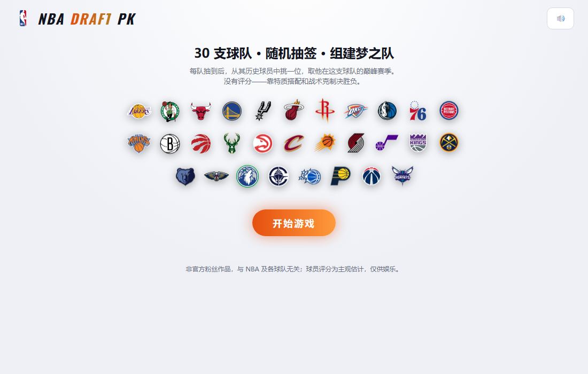
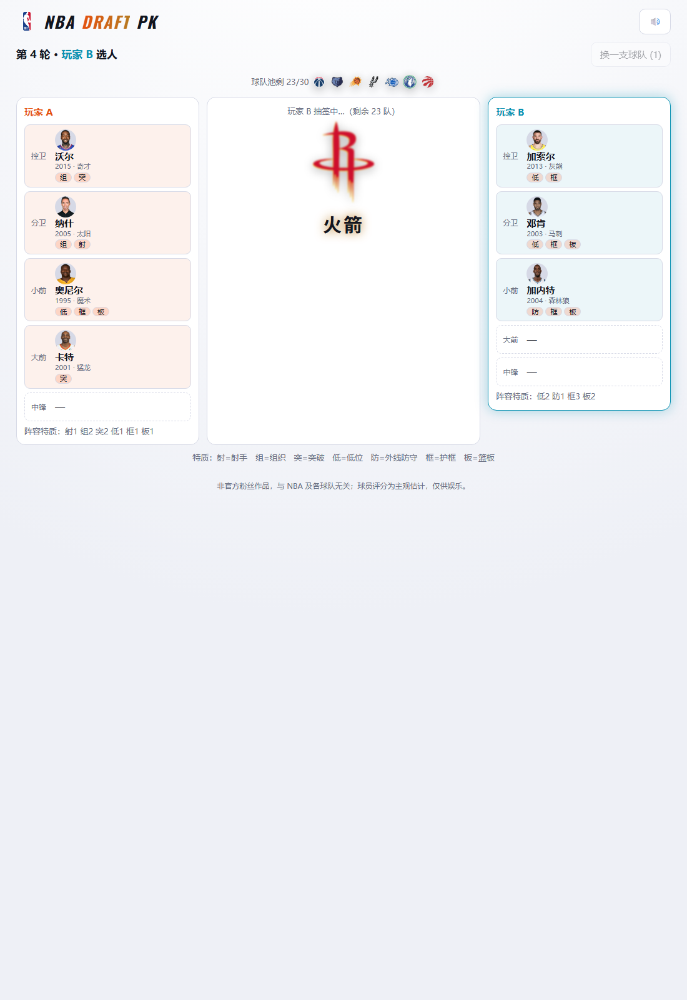
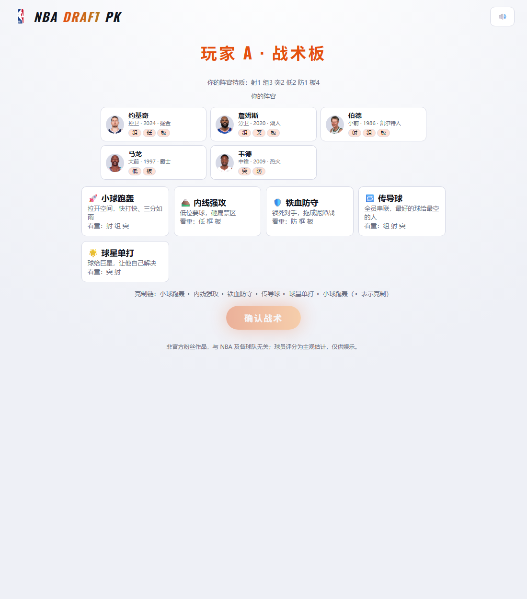
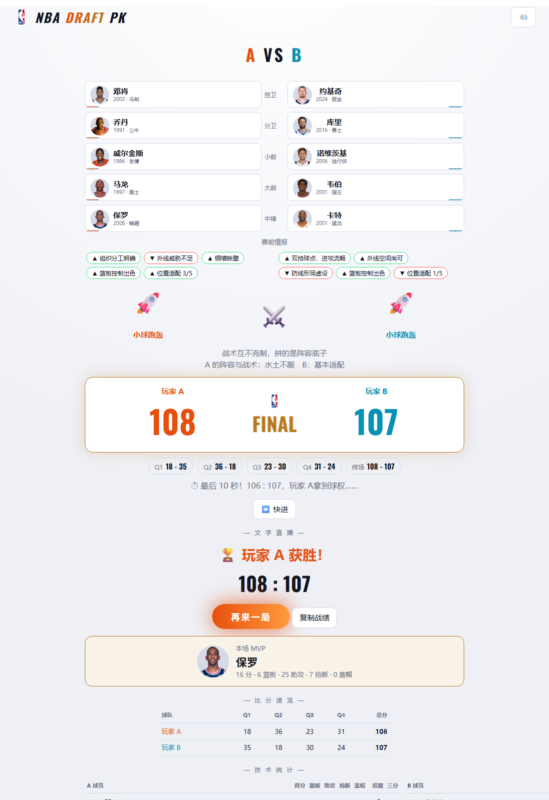
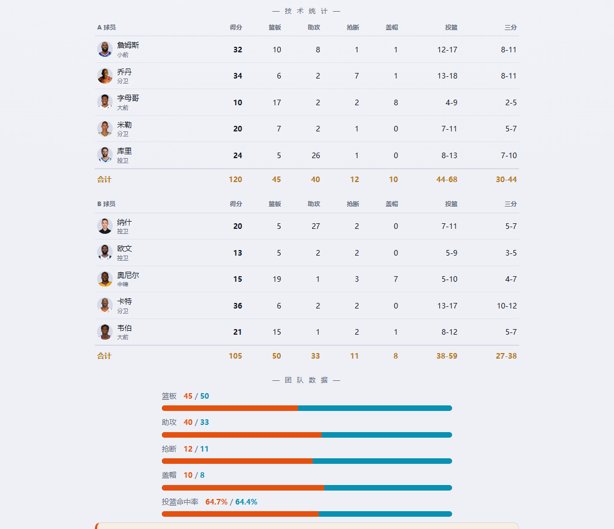

# 🏀 NBA 随机选秀 PK · NBA Draft PK

**单文件网页小游戏 · 随机抽队组建梦之队 · 战术博弈 · 比赛模拟 · 完整技术统计**

[**🎮 立即游玩**](https://fantasydq.github.io/nba-draft-pk/)  ·  [**English**](#-english)  ·  [**玩法**](#-怎么玩)  ·  [**特性**](#-核心特性)  ·  [**技术**](#-技术亮点)

 

---

## 📖 这是什么

一个**双人同屏**的 NBA 选秀对战小游戏：30 支球队随机抽签，从每支球队的**历史名宿**中挑人组建你的梦之队，然后布置战术、模拟比赛、看文字直播和技术统计，一决高下。

灵感来自经典页游《范特西篮球经理》的比赛模拟 —— 没有复杂数值，靠**阵容搭配、特质组合和战术克制**取胜。

## 🎮 怎么玩

**方式一（最简单）**：直接双击打开 `index.html`，无需联网、无需安装任何东西。

**方式二**：访问在线版 → [**fantasydq.github.io/nba-draft-pk**](https://fantasydq.github.io/nba-draft-pk/)

**方式三**：Fork 本仓库，开启 GitHub Pages（Settings → Pages → Branch: main / root）。

### 游戏流程

| 阶段 | 做什么 |
|------|--------|
| ① 随机抽队 | 系统从未抽过的球队中随机抽一支（**抽过的队不会再抽**），从它的 12-13 名历史球员里挑一位 |
| ② 组建阵容 | 双方交替抽队选人，共 5 轮，凑齐 控卫/分卫/小前/大前/中锋 五个位置 |
| ③ 部署战术 | 背靠背各选一套战术（小球跑轰 / 内线强攻 / 铁血防守 / 传导球 / 球星单打），互相克制 |
| ④ 模拟比赛 | 文字直播 + 实时比分 + 技术统计，紧张的 4 节大战，最后一攻定胜负 |
| ⑤ 查看数据 | 完整 box score、四节比分、团队数据对比、MVP 评选 |

### 操作提示

- 🖱️ 选秀：先点**球员卡**，再点己方**空位**（★ 标记 = 位置匹配）
- 🔄 每位玩家有 **1 次换队机会**（"换一支球队"按钮）
- ⏩ 比赛中可随时**快进 / 恢复常速**
- 🔊 右上角开关音效

## ✨ 核心特性

- 🎲 **随机抽队**：30 支 NBA 球队历史名宿池（275 位球星，取各自巅峰赛季）
- 🚫 **不重复抽队**：球队池实时显示剩余球队，抽过的队标变灰，绝不再抽
- 🖼️ **官方素材**：30 支球队官方矢量队标 + 229 位球员官方大头贴（全部内嵌，离线可用）
- 🧠 **战术克制**：五套战术循环克制（跑轰 ▸ 内线 ▸ 防守 ▸ 传导 ▸ 单打），还看阵容特质适配度
- 📊 **技术统计**：得分 / 篮板 / 助攻 / 抢断 / 盖帽 / 投篮 / 三分，实时更新 + 赛后完整 box score
- 📡 **文字直播**：带比赛时钟的逐回合解说，巨星招牌动作、绝杀时刻一应俱全
- 🏆 **赛后报告**：四节比分速览、团队数据对比条、MVP 评选、一键复制战报
- 📱 **移动端适配**：手机浏览器同样可玩，支持深色/浅色主题

## 🛠️ 技术亮点

- **真正的单文件**：整个游戏（逻辑 + 259 个内嵌素材）就是一个 `index.html`，约 5 MB，双击即玩
- **零依赖**：纯 Vanilla JS，无框架、无构建步骤、无网络请求（素材全部 Base64 内嵌）
- **离线优先**：在飞机上、断网环境、内网电脑都能玩；发给朋友一个文件就够了
- **智能兜底**：官方头像缺失的名宿自动使用队色卡通头像；图片加载失败自动降级
- **可验证的数据**：比赛统计自洽 —— 得分 = 2分命中×2 + 3分命中×3 + 罚球，三分命中 ≤ 投篮命中

## ❓ FAQ

**Q：能改球员数据 / 加球队吗？**
可以。所有球队和球员数据都在 `index.html` 顶部的 `raw` 变量里，格式为 `队标|队名|主色|辅色|球员,位置,评分,巅峰赛季,特质;...`，直接照着改。

**Q：评分是怎么定的？**
主观估计，取球员巅峰赛季的统治力，仅供娱乐，不代表历史地位。

**Q：为什么个别老球员是卡通头像？**
部分退役名宿在 NBA 官方 CDN 上只有灰色剪影占位图，与其 46 个人共用一张灰图，不如换成队色卡通头像。

**Q：支持在线联机吗？**
暂不支持。本作定位是双人同屏（一台设备两个玩家，战术环节有"请对手移开视线"的防偷看设计）。

## 🇺🇸 English

**NBA Draft PK** is a single-file browser game for two players sharing one screen:

1. **Draft** — randomly draw NBA teams (no team is drawn twice) and pick one legend per team to build your 5-man lineup
2. **Tactics** — each player secretly picks one of five tactics in a rock-paper-scissors cycle
3. **Simulate** — watch a play-by-play text broadcast with live score, game clock and full box score (PTS/REB/AST/STL/BLK/FG/3P)
4. **Result** — quarter-by-quarter score, team stat comparison, MVP and a shareable summary

Just open `index.html` — no internet, no install, no dependencies. Everything (including 259 embedded images) lives in one file.

## ⚖️ 免责声明

本项目为**非官方粉丝作品**，与 NBA 及其所属球队无关。NBA、球队名称及标识归各自权利人所有，仅用于非商业娱乐目的。球员评分为主观估计，不代表历史地位。如有侵权请联系，将立即处理。

## 📄 License

[MIT](LICENSE) © Curry (FantasyDQ)

---

如果觉得好玩，给个 ⭐ Star 支持一下吧！

